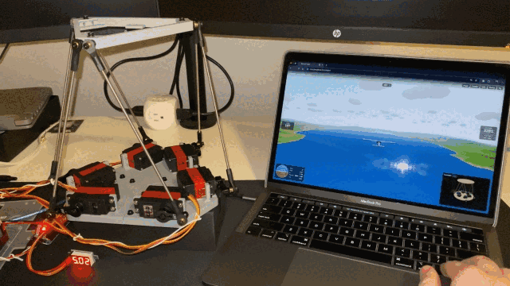
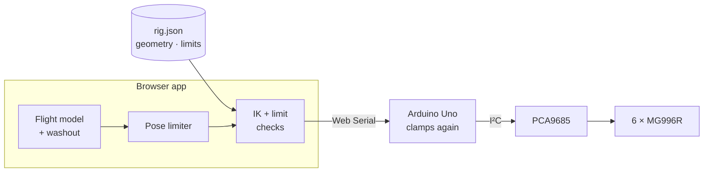
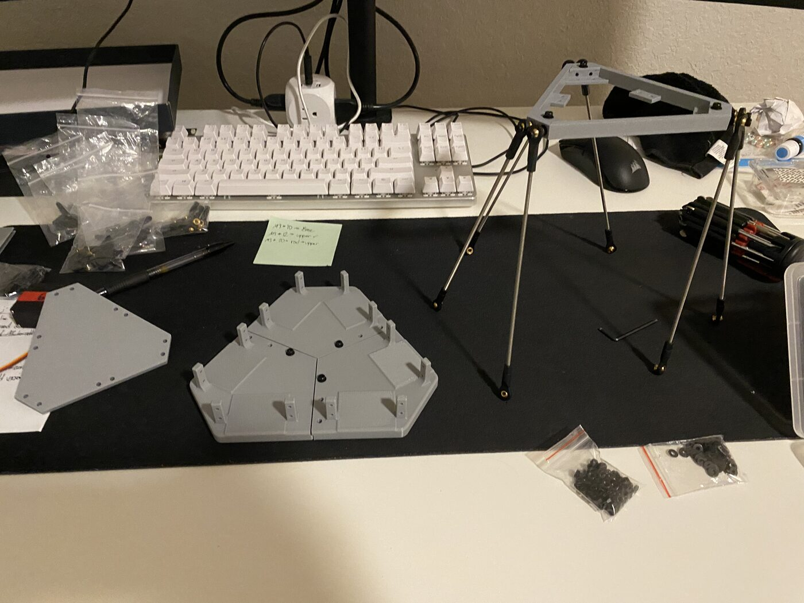
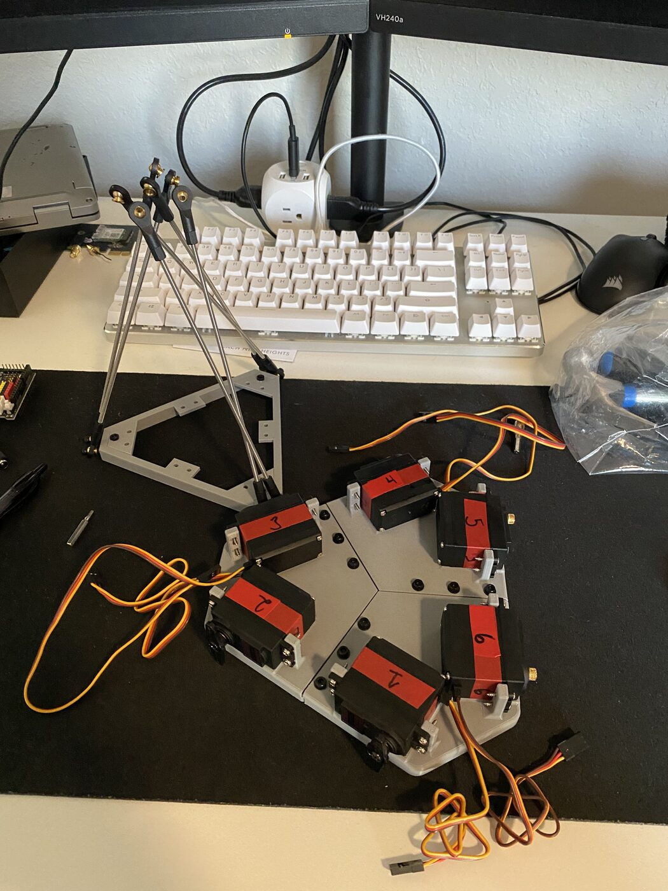
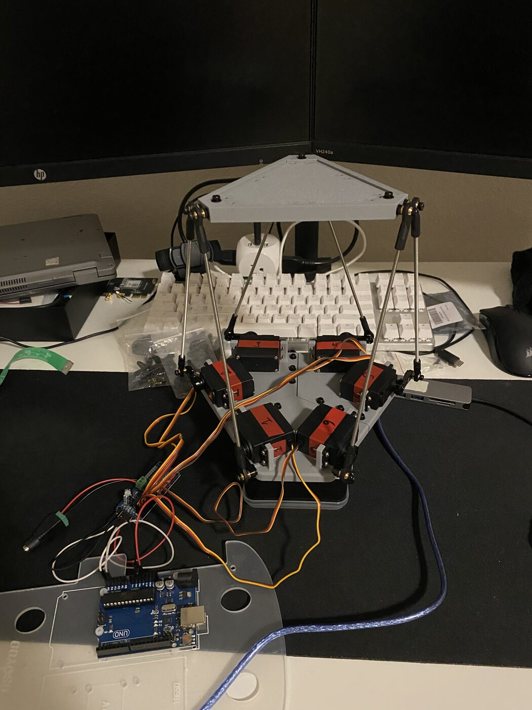
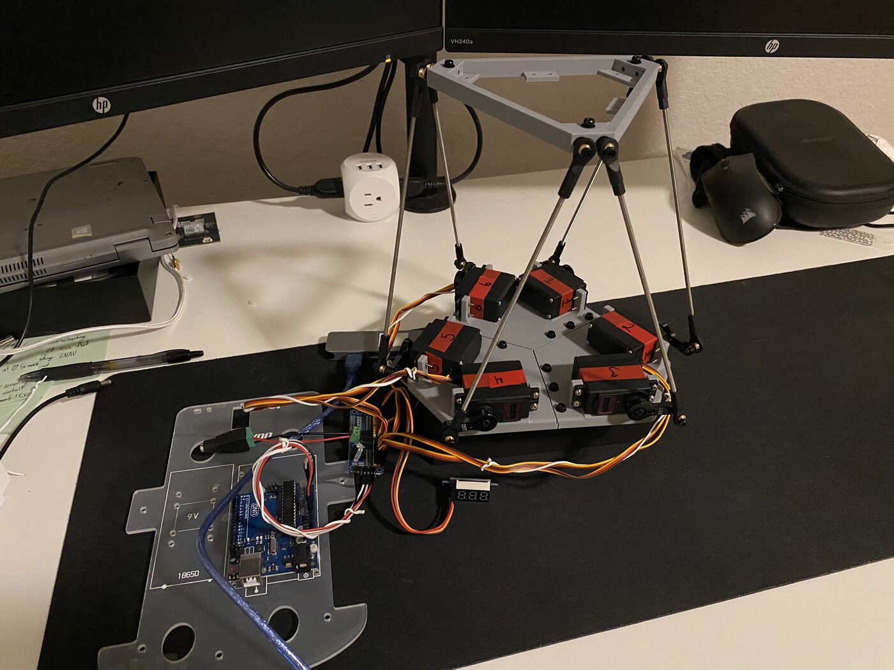
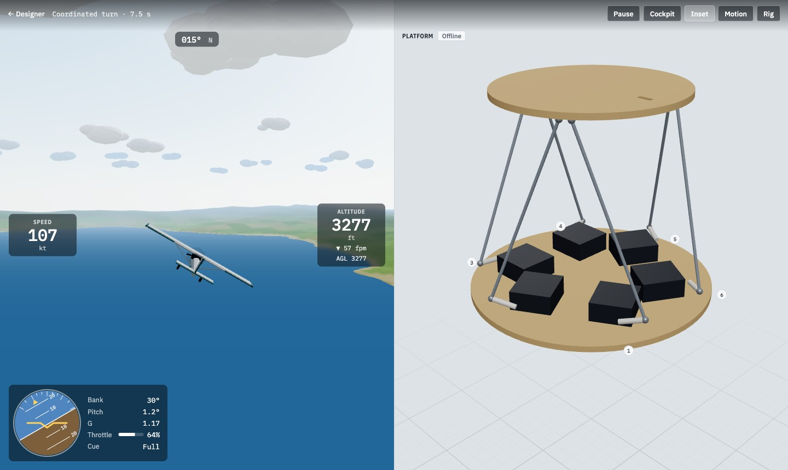
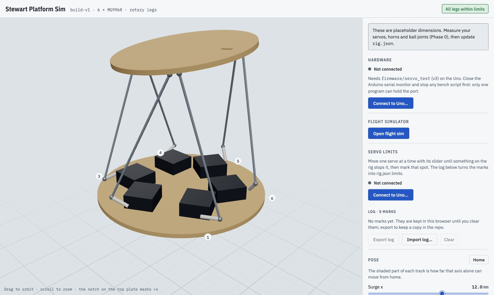
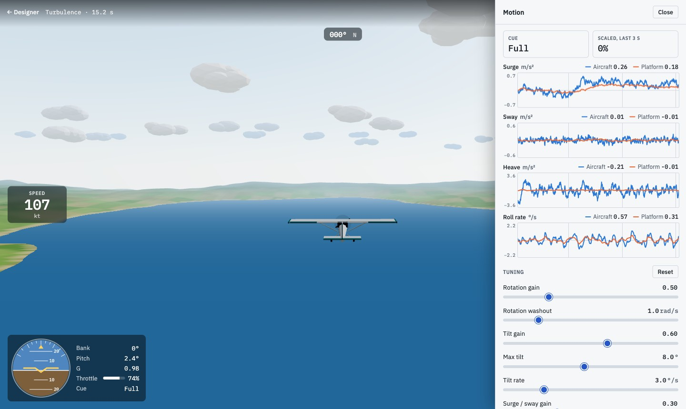

# Stewart Platform Sim

&nbsp;[Live demo](https://jayycub.github.io/stewart-sim/)

> Built with AI coding assistance (Claude Code) as a learning project: a hands-on way to explore kinematics,
> flight dynamics, motion cueing and embedded control on real hardware. It is not production or safety-certified software.

A browser-based design tool, simulator and controller for a six-axis rotary Stewart platform
(6 × MG996R servos, PCA9685, Arduino Uno). It designs the rig's geometry, checks every motion against the
machine's physical limits, and drives the real hardware, including from a built-in flight simulator.

## Features

- **Rig design:** closed-form inverse kinematics, servo, ball-joint and collision limits, a workspace map, a geometry
  optimiser, and 1:1 drilling templates for the plates
- **Flight simulator:** 6-DOF light-aircraft model (RK4, quaternions, trim, linearised modes, turbulence) in a 3D flight
  game, with classical washout cueing the motion onto the platform
- **Hardware control:** Web Serial live control and Python bench scripts, through firmware that buffers frames at 50 Hz
- **Verification:** ~250 tests in CI, including shared IK vectors, conservation-law checks on the dynamics, and every
  scripted manoeuvre's poses passing the rig's limit checks

## How it works

One config file defines the rig. Every pose is checked against it before it is sent, and the firmware clamps again.

## Build progress

| Printed parts and pushrods | Servos mounted | First assembly, wired to the Uno | Current build |
| --- | --- | --- | --- |
|  |  |  |  |

## Screenshots

| Flight sim beside the platform | Rig designer | Aircraft vs platform motion |
| --- | --- | --- |
|  |  |  |

## Stack

TypeScript, React, three.js (react-three-fiber), Zustand, Vite, Vitest · Arduino C++, PCA9685 · Python · GitHub Actions and Pages

## Status

The platform is assembled and flies with the simulator over live control. Next: replace the placeholder dimensions in
`rig.json` with measured ones, and move the IK into the firmware. Flying in the demo needs the rig connected.

[Plan](docs/PROJECT_PLAN.md) · [Status](docs/STATUS.md) · [Hardware](docs/HARDWARE.md) · [Decisions](docs/DECISIONS.md)
